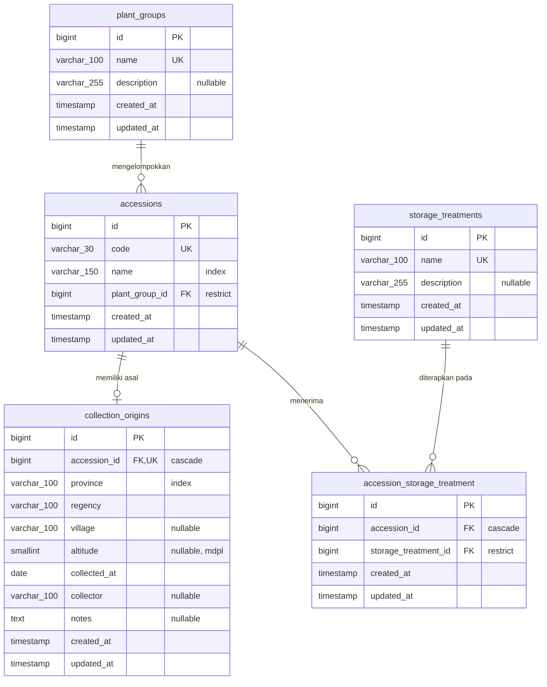
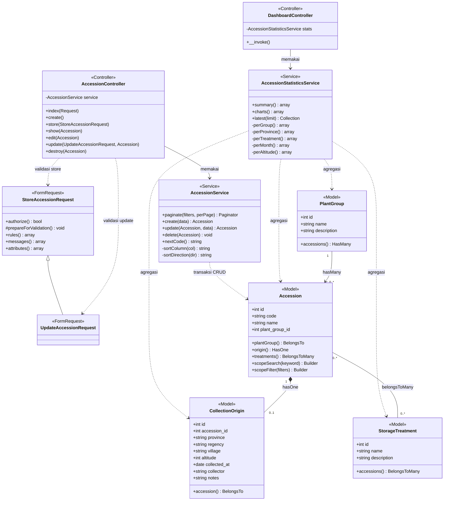

# Diagram Bank Benih Pusaka

Diagram memakai sintaks Mermaid (tampil otomatis di GitHub, GitLab, VS Code dengan ekstensi Mermaid,
atau tempel ke https://mermaid.live untuk diekspor menjadi PNG/SVG).

## 1. Entity Relationship Diagram (ERD)

Catatan: pasangan (`accession_id`, `storage_treatment_id`) pada tabel pivot memiliki unique constraint
`acc_treatment_unique`, sehingga satu perlakuan tidak bisa dipilih dua kali untuk aksesi yang sama.

## 2. Class diagram

## 3. Tabel kesesuaian diagram dengan implementasi

| Elemen diagram | Implementasi |
|---|---|
| `plant_groups` 1 — N `accessions` | `accessions.plant_group_id` FK `restrictOnDelete`; `Accession::plantGroup()` belongsTo, `PlantGroup::accessions()` hasMany |
| `accessions` 1 — 0..1 `collection_origins` | `collection_origins.accession_id` FK **unique** `cascadeOnDelete`; `Accession::origin()` hasOne, `CollectionOrigin::accession()` belongsTo |
| `accessions` N — M `storage_treatments` | tabel pivot `accession_storage_treatment` (FK `cascade` ke aksesi, `restrict` ke perlakuan, unique pasangan); `belongsToMany(...)->withTimestamps()` di kedua model |
| Aksesi wajib punya satu asal | database mengizinkan 0..1; aplikasi selalu membuat asal lewat `AccessionService::create()` dalam satu transaksi dan `origin` wajib pada Form Request |
| DashboardController → AccessionStatisticsService | controller invokable menerima service lewat constructor; service hanya melakukan agregasi (COUNT, GROUP BY) pada tabel yang sama dengan ERD, tanpa tabel baru |
| Controller → Service | `AccessionController` menerima `AccessionService` lewat constructor injection |
| Form Request | `UpdateAccessionRequest extends StoreAccessionRequest`; unik-kode memakai `Rule::unique()->ignore($this->route('accession'))` |
